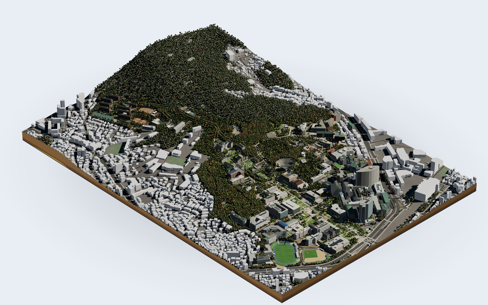
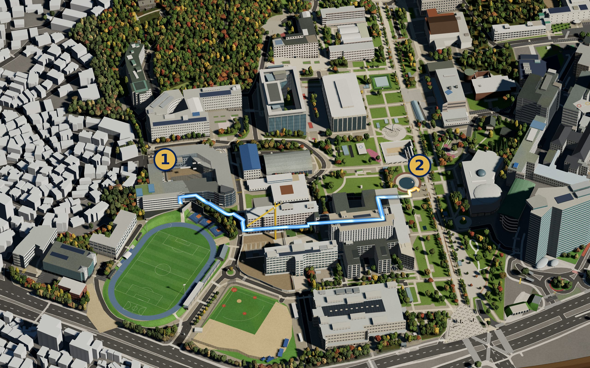
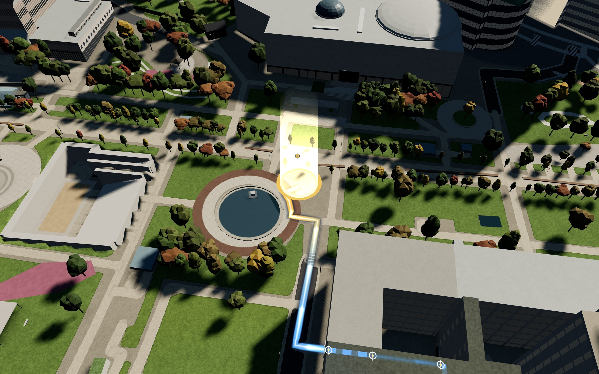
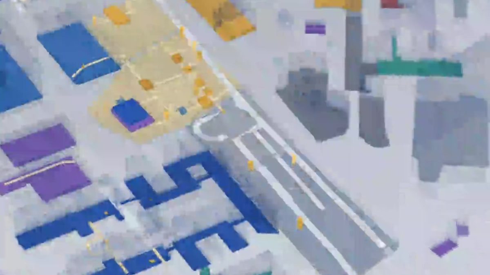
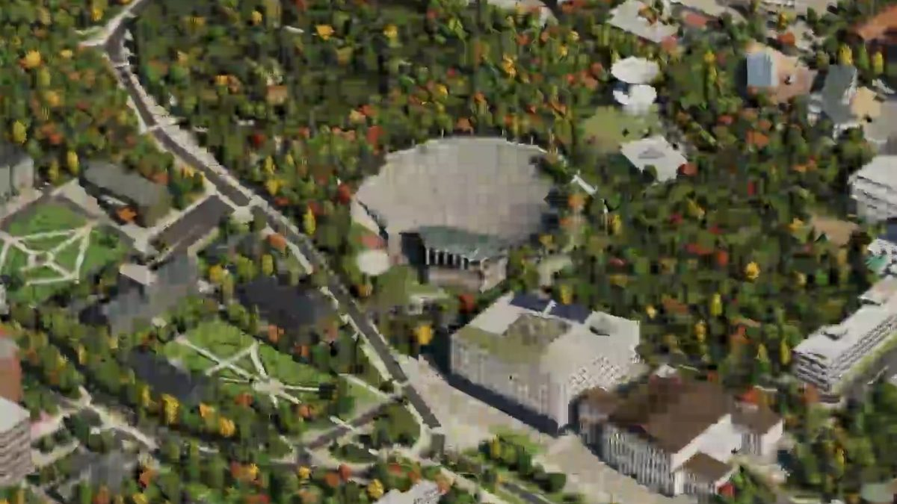

<p align="center">
  <picture>
    <source media="(prefers-color-scheme: dark)" srcset="docs/assets/nubi-mark-dark.svg">
    
  </picture>
</p>

<h1 align="center">Nubi</h1>

<p align="center">
  <b>Yonsei University's Sinchon campus as a map you can walk through.</b><br>
  <i>Nubi</i> (누비) comes from the Korean verb <i>nubida</i> (누비다), to roam all over a place freely. A 2.5–3D
  map of the campus, drawn from public data, with walking routes, the underground, facilities and their hours, and a
  map assistant you can ask in plain Korean.
</p>

<p align="center">
  <a href="https://nubi.yonsei.ac.kr"><b>nubi.yonsei.ac.kr</b></a> ·
  <a href="#features">Features</a> ·
  <a href="#the-assistant">Assistant</a> ·
  <a href="docs/user-guide.md">User guide</a> ·
  <a href="DATA_FORMAT.md">Data format</a> ·
  <a href="#data-sources-and-licences">Sources</a> ·
  <a href="#citation">Citation</a> ·
  <a href="#license">License</a> ·
  <a href="#acknowledgements">Acknowledgements</a>
</p>

> **Access:** sign up on [nubi.yonsei.ac.kr](https://nubi.yonsei.ac.kr/signup) with a Google account and agree to
> the terms. Yonsei University accounts (`@yonsei.ac.kr`) can use it at once; anyone else applies on the same page
> (name, affiliation, purpose), and access starts once the maintainer approves it. Nubi is in beta.
> [Privacy policy](https://nubi.yonsei.ac.kr/privacy) · [Terms](https://nubi.yonsei.ac.kr/terms)

<p align="center">
  <picture>
    <source media="(prefers-color-scheme: dark)" srcset="docs/assets/screenshots/campus-dark.jpg">
    
  </picture>
</p>

---

## What Nubi is

Nubi puts the Sinchon campus on one screen as a 3D map: every building with its real outline, height, roof and
facade, the paths, stairs, lawns and trees, the ground rising towards 안산, and the city blocks around it. You look
over it from above (3인칭, third person) or walk it at eye level (1인칭, first person). Over the map sits one question
box: type a place to fly there, or ask a question and the assistant answers on the map.

Nothing in the map is a photograph or a third-party 3D model. Outlines, heights and paths come from public datasets;
roofs, facades, gates, stairs, pitches and statues are modelled from those facts and checked by hand, cell by cell,
against several references (see [Data sources](#data-sources-and-licences)). The main users are Yonsei students:
new students finding their first lecture room, and everyone looking for the step-free way, an open café or some
shade.

| | |
|---|---|
| **Map** | the campus in 2.5–3D in the browser (WebGL), third person and first person, light and dark themes, the real sun position for any time and date in Sinchon |
| **Routes** | walking routes between any two places, in three profiles: 최단 (quickest), 계단 없이 (step-free) and 오르막 적게 (least climbing), drawn on the ground as a glowing line with time, distance, climb and steps |
| **Underground** | a 지하 (underground) view that turns the ground to glass: 백양누리 and its floors, the basement levels of every building and the underground passages |
| **Places and facilities** | buildings, halls and outdoor places by name; cafeterias, cafés, convenience stores, reading rooms, printers, ATMs, shuttle stops, AEDs and more, with their opening hours and whether they are open now |
| **Nearby** | restaurants and cafés within about 1 km of the campus, ordered by real walking time |
| **Shade and time** | move the clock to see the light and the shadows, or ask how much of a place is in shade at a given time |
| **Tours** | a guided camera tour over the stops you ask for |
| **Assistant** | a map assistant that answers in Korean using Nubi's own data and tools, and shows the answer on the map |
| **Campus data** | everything above in one versioned SQLite release with a documented schema ([DATA_FORMAT.md](DATA_FORMAT.md)) |

## Features

### Routes: three ways to walk



The route engine runs over the walkable network of the campus (paths, stairs, crossings, underground passages and
building entrances) laid on the map's own ground, so every edge knows its length, climb and steps. Walking time
follows Tobler's hiking function. You choose:

| Profile | What it optimises |
|---|---|
| **최단** (quickest) | walking time, slopes included |
| **계단 없이** (step-free) | avoids every flight of steps; a route exists only if a step-free way does |
| **오르막 적게** (least climbing) | the metres climbed, for hot days and heavy bags |

The route is drawn on the ground as a line of light that stays visible through buildings, with a card that gives the
time, distance, climb, steps and the turns in words. The assistant's route answers come from the same engine.



### Underground: 백양누리 and the basements



Much of the campus is below ground: 백양누리 under 백양로, parking, halls, cafeterias and plant rooms. The 지하 view
makes the ground and the buildings transparent, lets you pick a level (B1 to B7), and colours each basement by its
use (parking, food, lecture, research, plant …) from the building register's floor records. 백양누리's floors, halls,
exits, stairs and elevators are modelled separately, and routes can pass through the underground passages.

### Facilities and opening hours


About 190 facilities on campus (cafeterias, cafés, convenience stores, bookstores, reading rooms, printing, ATMs and
the bank, shuttle stops, AEDs, accessible toilets and more), each with its building and floor, its hours by season
(semester, vacation) and the page it was read from. Whether a place is open is computed for the moment you ask, with
the academic calendar and public holidays. Where hours are not published, Nubi says it does not know rather than
guess.

Around the campus, restaurants and cafés within about 1 km come from the public business-licence records (only
places still in business), joined to OpenStreetMap for their kind and hours. They are ordered by actual walking time,
and an unknown opening time is shown as unknown, with a link to check it.

### Shade, light and time



The map's sun is the real sun over Sinchon. Move the time bar to any hour and date, play a sunset, or ask how much of
노천극장's seats are in the shade at 3 p.m.; the answer is computed from the buildings, the trees and the hill
(approximate, and said to be).

### First person

Walk at eye level with the keyboard or an on-screen joystick. Walls stop you; stairs, ramps and slopes follow the
ground. The 1인칭 / 3인칭 switch is at the top left of the map.

## The assistant

The question box over the map is also a map assistant. It answers in Korean, only from Nubi's data and tools, and
shows the result on the map (it flies there, draws the route, pins the facilities, sets the time). The assistant is
powered by Anthropic's Claude model; each person has a daily allowance.

Questions it is made for:

- *"첨단관에서 백양누리 가는 길 알려줘"* (the way from 첨단과학관 to 백양누리): a route with time, distance and steps.
- *"학생회관에서 중앙도서관, 계단 없이"*: the step-free route.
- *"지금 열린 카페 어디 있어?"* (which cafés are open now?): facilities open at this moment, nearest first.
- *"정문 근처 한식집, 걸어서 5분 안"*: restaurants by walking time, open or not.
- *"노천극장 오후 3시에 그늘 얼마나 돼?"*: the share of seats in shade.
- *"20분짜리 캠퍼스 투어 보여줘"*: a guided camera tour.
- *"백양누리 지하 2층에 뭐가 있어?"*: a level of the underground.
- *"지하에 주차장이 있는 건물은?"*, *"가장 오래된 건물은?"*: questions answered from the campus data release with
  read-only queries.

It does not invent hours, rooms or routes: when the data does not say, it says so.

## Using Nubi

1. Open [nubi.yonsei.ac.kr](https://nubi.yonsei.ac.kr) and sign in with Google (sign up once first).
2. The map is the main page. Drag to turn, scroll or pinch to zoom; 1인칭 to walk.
3. Type a building or place in the question box to fly there, or type a question and press Enter.
4. On a place card, press 여기까지 길찾기 (route here) or 여기서 출발 (start here); switch between 최단, 계단 없이 and
   오르막 적게 on the route card.
5. Press 지하 on the map's controls to look below ground.

The full walk-through is in [docs/user-guide.md](docs/user-guide.md).

## Campus data

Everything the map and the assistant know is built into one versioned file: the **nubi-campus** release (release
1.1, schema 1.1.0), a single SQLite database of about 14 MB.

- 42 tables: buildings and their pieces, the building register (title and floor records), levels and their uses,
  entrances, 백양누리's sections, rooms and connections, underground ways and points, facilities and their hours,
  the academic calendar, zones and their features, paths, green areas, trees, the city around, and the walking graph.
- Indoor tables follow **IMDF** (venue → building → level → unit / opening / amenity), so lecture rooms and interiors
  can be added without changing the shape.
- One naming rule for every column (the unit last: `height_m`, `area_m2`; counts `n_`, booleans `is_` / `has_`);
  levels as IMDF ordinals (`0` = 1층, `-1` = B1); every row carries the ids of the sources it came from, and estimated
  values are flagged (`is_est`).
- The schema itself is inside the file (every table and column with its type, unit and meaning in English and
  Korean, every vocabulary), and an R-tree index answers "within N metres" and "nearest".
- The same commit always builds the same file, byte for byte.

The schema manual is [DATA_FORMAT.md](DATA_FORMAT.md). Today the release is read through the map and the assistant;
it is not offered as a download.

## What Nubi is not

- **Not an official Yonsei University service.** Nubi is an independent personal project. Official information is on
  the university's own pages; Nubi links to them.
- **No course catalogue.** Nubi does not collect or store the 수강편람 or the university's room-occupancy data.
- **No room booking, no indoor floor plans of others.** Booking is on the university's own systems. Third-party floor
  plans, indoor maps and 360° photos are never copied into Nubi.
- **Not a live map.** The site calls no external map service while you use it; the data is built offline and
  updated with each release.

## Data sources and licences

Each item comes from the most detailed source that allows it to be stored and reused. Where sources disagree, they are
compared against each other (OpenStreetMap, the public datasets, aerial imagery and 360° views used as references)
and the best-supported value is kept. The same list is on the site's 출처 (credits) page.

| Data | Source | Licence | Attribution |
|---|---|---|---|
| Paths, stairs, roads, lawns, woods, water, trees; some building names and outlines; facility points; restaurant kinds and hours | [OpenStreetMap](https://www.openstreetmap.org/copyright) | ODbL 1.0 | © OpenStreetMap contributors |
| Surveyed building outlines and their register ids | GIS건물통합정보 (integrated GIS building data), Ministry of Land, Infrastructure and Transport (국토교통부), via the V-World open platform | CC BY | 국토교통부, GIS건물통합정보 |
| Storeys above and below ground, height, structure, roof, approval year; floor-by-floor area and use | 건축물대장 (building register: 표제부 title records and 층별개요 floor records), 국토교통부 건축HUB, via [data.go.kr](https://www.data.go.kr/data/15134735/openapi.do) | Korea public data, no restriction on use (이용허락범위 제한 없음) | 국토교통부 건축HUB |
| Restaurants and cafés around the campus (name, address, position, business type, status) | 지방행정 인허가 데이터 (LOCALDATA business licences: general and rest restaurants), Ministry of the Interior and Safety (행정안전부), via [data.go.kr](https://www.data.go.kr/data/15045016/fileData.do) | Korea public data, no restriction on use | 행정안전부 |
| Terrain | [Copernicus DEM GLO-30](https://spacedata.copernicus.eu/) | Copernicus DEM licence | © DLR e.V. 2010-2014 and © Airbus Defence and Space GmbH 2014-2018, provided under COPERNICUS by the European Union and ESA |
| Facility names, places and opening hours; shuttle, parking, AEDs; the academic calendar; 백양누리's floors | Yonsei University and Yonsei University Library web pages | facts only (no text or images copied beyond short quotes) | the page and the day it was read are kept per facility |
| 3D rendering in the browser | [three.js](https://github.com/mrdoob/three.js) r170 | MIT | three.js authors |

**Used as reference only, never stored or redistributed:** the V-World (공간정보 오픈플랫폼) aerial imagery and 3D map,
viewed during development to choose roof colours and check facade rhythm and heights; and the 서대문구 360° VR tour,
viewed like any visitor to check details invisible from above; and 나무위키 (namu.wiki), consulted only for
a position or a room-code convention when no other source had one. Captures were looked at once and deleted; only Nubi's
own values remain, each noted with the reference it was checked against. Naver and Kakao maps are only linked to,
never read.

Every map screen shows "© OpenStreetMap · 건축물대장 · GIS건물통합정보 · Copernicus" with a link to the credits page.

## Citation

If you use Nubi or its campus data, please cite it, and cite the original data sources listed above. GitHub's "Cite
this repository" button reads [`CITATION.cff`](CITATION.cff).

```bibtex
@misc{park2026nubi,
  author = {Park, Jimin},
  title  = {{Nubi}: A Walkable 3D Map of Yonsei University's Sinchon Campus},
  year   = {2026},
  url    = {https://nubi.yonsei.ac.kr},
  note   = {Campus data release 1.1}
}
```

## License

- **This documentation and the images in this repository**: [CC BY 4.0](LICENSE).
- **Map data**: Nubi does not relicense its sources. Data derived from OpenStreetMap stays under the ODbL 1.0; the
  public datasets keep their own terms (see the table above). Attribute the original sources when you use or share
  anything derived from them.
- The source code of the site is not published in this repository.

## Acknowledgements

<p>
  <a href="https://www.mpmc.yonsei.ac.kr/"></a>
</p>

I thank Prof. Jung-Il Choi and the [Multi-Physics Modeling & Computation Lab (MPMC)](https://www.mpmc.yonsei.ac.kr/),
Yonsei University, for supporting this project.

I also thank Yonsei University for providing the domain **nubi.yonsei.ac.kr**.

Nubi is an independent personal project, developed and maintained by Jimin Park, who holds its copyright. It is not
an official service of Yonsei University; the licenses are listed [above](#license).

<br clear="right">

## Contact

Jimin Park, Department of Battery Conflation Engineering, Yonsei University — pjm@yonsei.ac.kr

Nubi exists because OpenStreetMap's contributors and Korea's public-data programmes publish their data openly.
